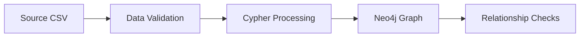
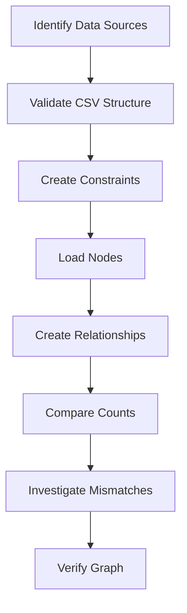

<div align="center">

# Neo4j Graph Data Workflows

### Graph Data Engineering | Cypher | Data Validation

A technical case study demonstrating graph-based
data modeling, relationship management, and
data validation using Neo4j.

<br>


**Graph Modeling • Data Loading • Relationship Integrity • Query Optimization**

</div>

---

## 01 / Project Overview

Graph databases provide a flexible approach
to representing interconnected information.

In engineering systems, data frequently
contains complex relationships between
parts, revisions, components, and users.

This repository demonstrates graph data
engineering concepts using Neo4j and Cypher.

### Objectives

- Model interconnected engineering information
- Load structured data into Neo4j
- Create relationships between entities
- Validate graph data integrity
- Identify duplicates and missing relationships
- Explore graph traversal queries

---

## 02 / Engineering Challenges

| Challenge | Engineering Approach |
|:---|:---|
| Large datasets | Batch-based data loading |
| Duplicate records | Unique identifiers and constraints |
| Missing relationships | Relationship validation |
| Data inconsistencies | Source-to-target comparison |
| Query performance | Indexes and query profiling |
| Data reloads | Repeatable loading procedures |

---

## 03 / Graph Data Architecture

### Conceptual Data Processing Workflow



This diagram describes a generic graph
data loading and validation approach.

### Example Graph Data Model


**Example Entity:** PartRevision

**Example Relationship:** HAS_COMPONENT

All identifiers shown in this repository
are fictional and used for demonstration.

---

## 04 / Creating Graph Data

### Step 1 — Define a Uniqueness Constraint

```cypher
CREATE CONSTRAINT part_revision_id_unique
IF NOT EXISTS
FOR (r:PartRevision)
REQUIRE r.revision_id IS UNIQUE;
```

This helps prevent duplicate PartRevision
nodes with the same revision identifier.

### Step 2 — Create Sample Nodes

```cypher
UNWIND [
  {
    id: 'PR-100-A',
    name: 'Main Assembly'
  },
  {
    id: 'PR-200-A',
    name: 'Motor Component'
  },
  {
    id: 'PR-300-A',
    name: 'Housing Component'
  }
] AS item

MERGE (r:PartRevision {
  revision_id: item.id
})

SET r.name = item.name;
```

### Step 3 — Create Relationships

```cypher
MATCH (a:PartRevision {
  revision_id: 'PR-100-A'
})

MATCH (b:PartRevision {
  revision_id: 'PR-200-A'
})

MATCH (c:PartRevision {
  revision_id: 'PR-300-A'
})

MERGE (a)-[:HAS_COMPONENT]->(b)

MERGE (a)-[:HAS_COMPONENT]->(c);
```

---

## 05 / Querying Graph Relationships

### Find Components of an Assembly

```cypher
MATCH (assembly:PartRevision {
  revision_id: 'PR-100-A'
})-[:HAS_COMPONENT]->(component)

RETURN
  assembly.revision_id AS assembly,
  component.revision_id AS component,
  component.name AS component_name;
```

### Count Graph Nodes

```cypher
MATCH (r:PartRevision)

RETURN count(r) AS total_revisions;
```

### Count Relationships

```cypher
MATCH ()-[r:HAS_COMPONENT]->()

RETURN count(r) AS total_relationships;
```

---

## 06 / CSV-Based Data Loading

Structured CSV files can be used
to create nodes and relationships.

### Example CSV Structure

```csv
revision_id,name
PR-100-A,Main Assembly
PR-200-A,Motor Component
PR-300-A,Housing Component
```

### Example Loading Query

```cypher
LOAD CSV WITH HEADERS
FROM 'file:///part_revisions.csv'
AS row

WITH row
WHERE row.revision_id IS NOT NULL
  AND trim(row.revision_id) <> ''

MERGE (r:PartRevision {
  revision_id: trim(row.revision_id)
})

SET r.name = row.name;
```

The CSV must be accessible to the Neo4j
database through an allowed import location.

For larger datasets, transaction batching,
memory usage, and database configuration
should be evaluated.

---

## 07 / Data Validation

Data validation helps identify discrepancies
between expected and loaded graph information.

### Check Duplicate Identifiers

```cypher
MATCH (r:PartRevision)

WITH
  r.revision_id AS revision_id,
  count(*) AS occurrences

WHERE occurrences > 1

RETURN revision_id, occurrences;
```

### Inspect Relationships

```cypher
MATCH (a:PartRevision)
      -[:HAS_COMPONENT]->
      (b:PartRevision)

RETURN
  a.revision_id AS parent,
  b.revision_id AS component

ORDER BY parent, component;
```

### Find Nodes Without Outgoing Components

```cypher
MATCH (r:PartRevision)

WHERE NOT (r)-[:HAS_COMPONENT]->()

RETURN r.revision_id;
```

Note: Nodes without outgoing components
may be valid leaf components.

Their presence does not automatically
indicate a data quality issue.

### Case-Sensitive Identifiers

Graph identifiers should be handled
according to the source system's rules.

Avoid automatic case conversion when
identifiers are case-sensitive.

---

## 08 / Engineering Workflow



### Validation Checklist

- Confirm expected node counts
- Verify relationship counts
- Check uniqueness constraints
- Identify unmatched source references
- Validate case-sensitive identifiers
- Test representative graph queries

---

## 09 / Performance Considerations

Graph loading performance depends on:

- Dataset size
- Query structure
- Available memory
- Indexes and constraints
- Transaction batch size
- Relationship matching complexity

### Optimization Techniques

**Constraints and Indexes**

Use appropriate constraints and indexes
for frequently matched identifiers.

**Batch Processing**

Process large datasets in manageable
transactions where supported.

**Query Profiling**

Use Neo4j EXPLAIN and PROFILE to
inspect query execution behavior.

**Data Validation**

Compare source and target counts
to identify incomplete loading.

---

## 10 / Repository Scope

This repository contains educational
and technical examples of graph
data engineering workflows.

All sample identifiers and records
are fictional.

No internal company records,
production endpoints, proprietary
datasets, or credentials are included.

---

<div align="center">

### Building Reliable Graph Data Systems

**Hemaa Mathiyarasu**

[](https://hemaamathiyarasu.netlify.app/)
[](https://github.com/hemaamathiyarasu)

</div>
